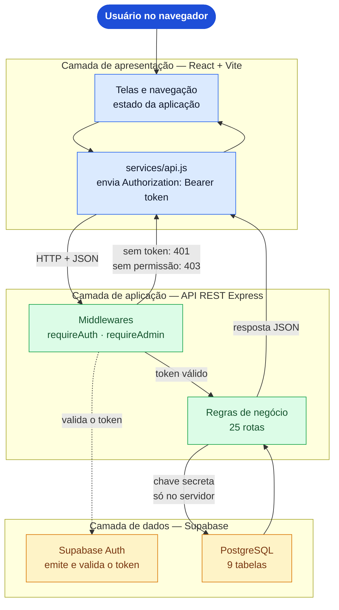
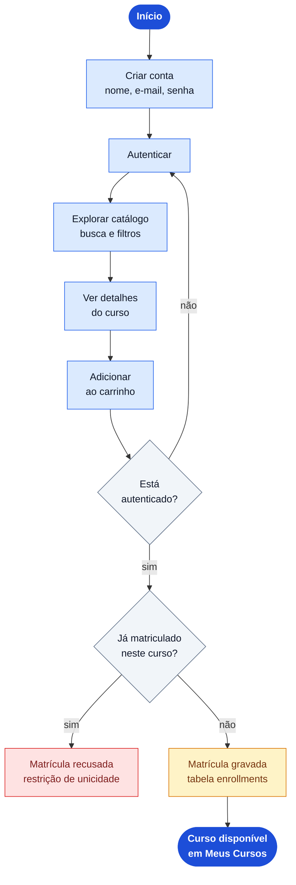
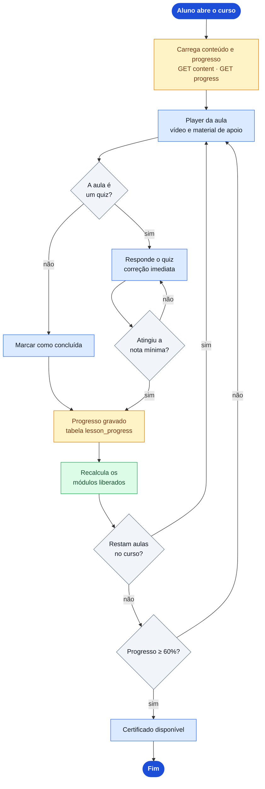
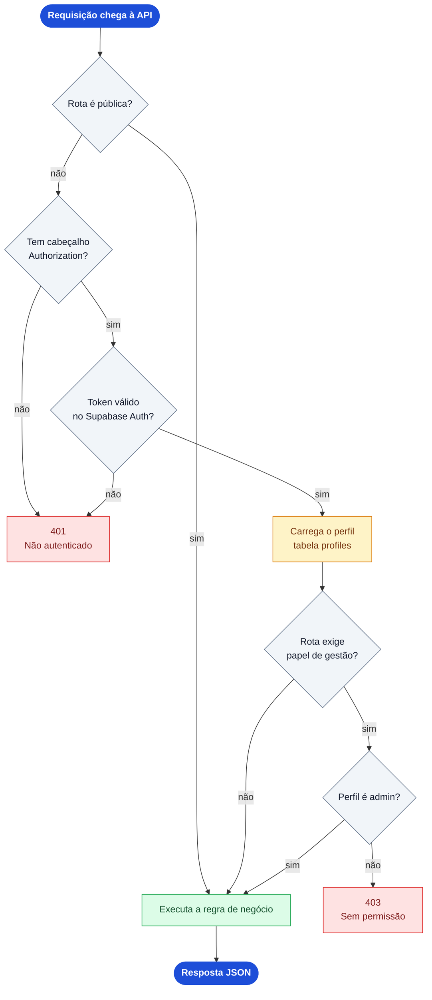
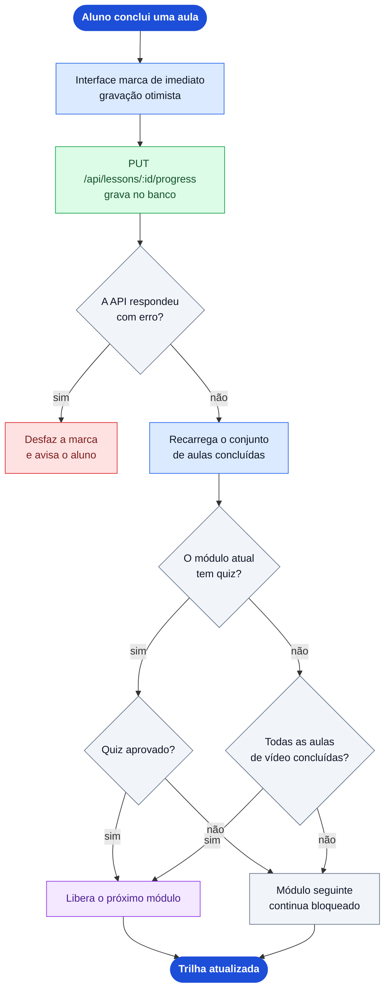
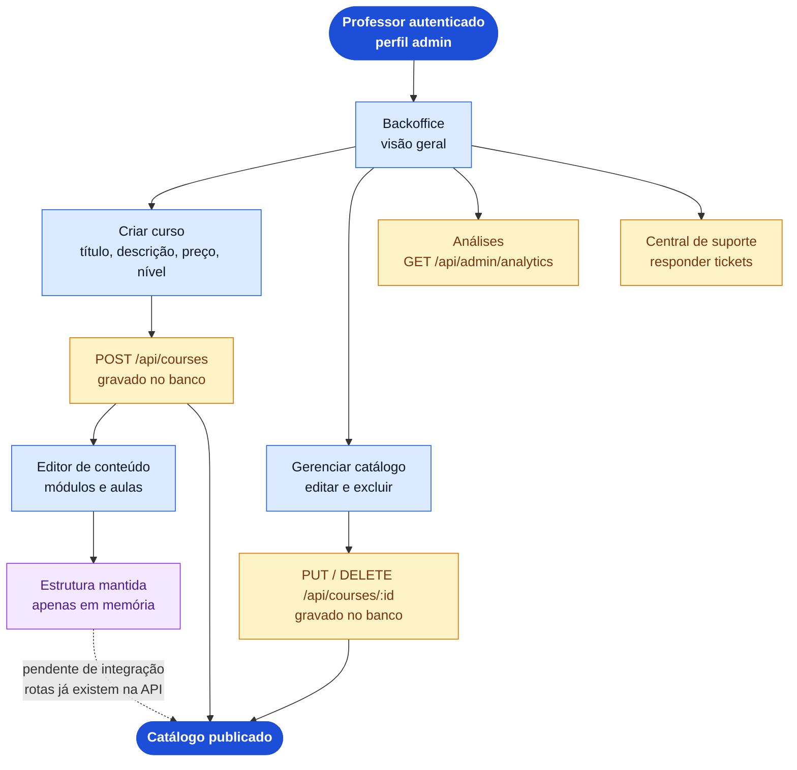

# Fluxogramas do CursoLab — código-fonte

Os diagramas abaixo estão em Mermaid. Para editar, cole o bloco em
https://mermaid.live, ajuste e exporte de novo em PNG ou SVG.

## Arquitetura em camadas e trajeto de uma requisição

Arquivo: `FL-01-arquitetura.png`

---

## Jornada do aluno — descoberta e matrícula

Arquivo: `FL-02-aluno-aquisicao.png`

---

## Jornada do aluno — aprendizado e certificado

Arquivo: `FL-03-aluno-aprendizado.png`

---

## Autenticação e controle de acesso

Arquivo: `FL-04-autenticacao-autorizacao.png`

---

## Regra de progressão e desbloqueio de módulos

Arquivo: `FL-05-progressao-modulos.png`

---

## Fluxo do professor / administração

Arquivo: `FL-06-fluxo-do-professor.png`

