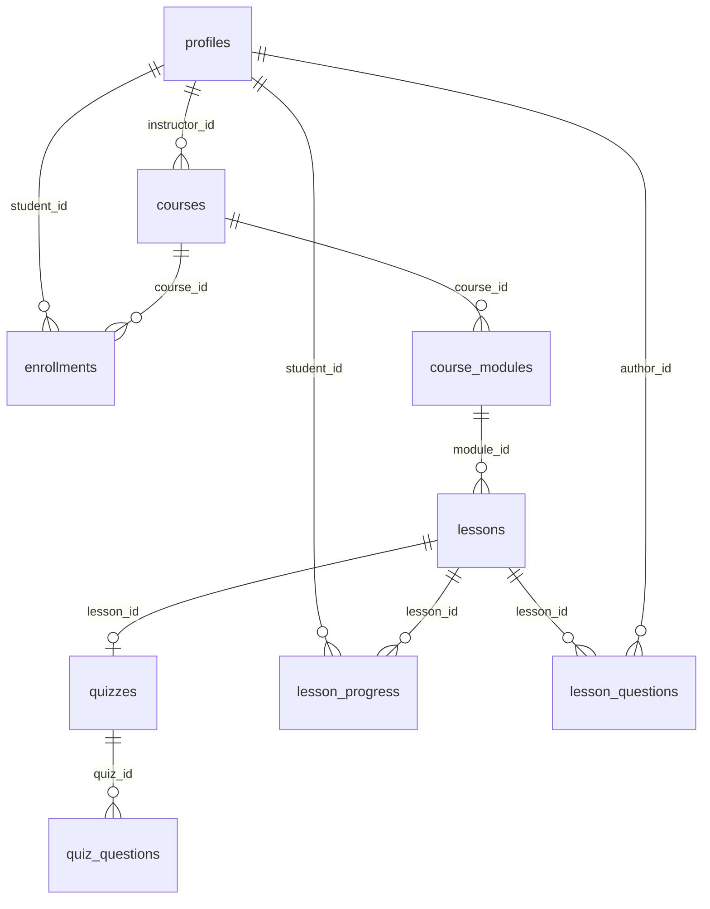

# Roteiro de figuras — documentação de requisitos

Este arquivo lista as 20 figuras do documento, o que cada uma precisa mostrar e como
chegar à tela. Serve tanto para captura manual quanto para captura automatizada.

Salvar as imagens em `docs/imagens/` com os nomes indicados.

## Preparação do ambiente

Antes de capturar, deixar a aplicação em um estado apresentável:

1. Subir os dois serviços:
   ```bash
   npm run server    # API em http://localhost:3001
   npm run dev       # interface em http://localhost:5173
   ```
2. Ter duas contas prontas: uma de **aluno** e a de **administrador** de demonstração.
3. O aluno precisa estar matriculado em pelo menos um curso, com **uma aula concluída**
   (para a barra de progresso não aparecer zerada) e **uma dúvida enviada e respondida**.
4. Usar a janela do navegador **maximizada** e sempre na **mesma largura**, para que todas
   as figuras tenham proporção uniforme no documento.
5. Preferir capturar apenas a área de conteúdo relevante, sem a barra de ferramentas do
   navegador.

## Lista de figuras

| # | Arquivo | Tela | O que precisa aparecer |
|---|---|---|---|
| 1 | `fig-01-casos-de-uso.png` | Diagrama | Diagrama de casos de uso (ver especificação abaixo) |
| 2 | `fig-02-login.png` | Login / Cadastro | Formulário de cadastro com os campos nome, e-mail e senha |
| 3 | `fig-03-busca.png` | Home | Autocomplete aberto, com sugestões visíveis sob o campo de busca |
| 4 | `fig-04-filtros.png` | Home | Filtros aplicados e a contagem "N cursos encontrados" |
| 5 | `fig-05-detalhes.png` | Detalhes do curso | Título, instrutor, preço, grade curricular e botões de compra |
| 6 | `fig-06-carrinho.png` | Carrinho | Item no carrinho, campo de cupom e resumo com o total |
| 7 | `fig-07-player.png` | Player | Vídeo, barra de progresso e trilha lateral com módulo bloqueado |
| 8 | `fig-08-quiz.png` | Player (quiz) | Pergunta de múltipla escolha com as alternativas |
| 9 | `fig-09-certificados.png` | Painel do aluno | Aba "Certificados" com o percentual de conclusão |
| 10 | `fig-10-duvidas.png` | Player | Área de dúvidas com uma pergunta e a resposta do professor |
| 11 | `fig-11-avaliacao.png` | Painel do aluno | Modal de avaliação com as estrelas e o campo de comentário |
| 12 | `fig-12-suporte.png` | Painel do aluno | Aba "Suporte" com o formulário de ticket |
| 13 | `fig-13-criar-curso.png` | Backoffice | Formulário "Criar curso", com os campos preenchidos |
| 14 | `fig-14-editor-modulos.png` | Editor de conteúdo | Curso com ao menos um módulo já criado |
| 15 | `fig-15-cadastro-aula.png` | Editor de conteúdo | Formulário de aula com duração, tipo e URLs |
| 16 | `fig-16-editar-curso.png` | Backoffice | Edição de metadados, com o campo de preço em evidência |
| 17 | `fig-17-duvidas-admin.png` | Backoffice | Painel de dúvidas pendentes com o campo de resposta |
| 18 | `fig-18-gerenciar.png` | Backoffice | Aba "Gerenciar cursos" com a lista e as ações |
| 19 | `fig-19-analises.png` | Backoffice | Aba "Análises" com os indicadores |
| 20 | `fig-20-modelo-dados.png` | Diagrama | Diagrama entidade-relacionamento (ver especificação abaixo) |

## Figura 1 — Especificação do diagrama de casos de uso

As figuras 1 e 20 são diagramas, não capturas de tela. Podem ser desenhadas no draw.io,
no Lucidchart ou em qualquer ferramenta UML. Abaixo está o conteúdo exato de cada uma.

**Fronteira do sistema:** retângulo rotulado "Sistema de Cursos Online".

**Ator Aluno** — conectado aos casos de uso:

- Criar Conta *(novo)*
- Autenticar *(novo)*
- Recuperar Senha *(novo)*
- Buscar Cursos
- Filtrar Resultados
- Visualizar Detalhes do Curso
- Adicionar ao Carrinho
- Realizar Compra
- Assistir Aulas
- Realizar Quizzes
- Fazer Perguntas
- Emitir Certificado
- Avaliar Curso
- Abrir Ticket Suporte

**Ator Professor / Instrutor** — conectado aos casos de uso:

- Criar Curso
- Gerenciar Módulos
- Upload de Conteúdo
- Definir Preço
- Responder Perguntas
- Gerenciar Catálogo *(novo)*
- Acessar Dashboard

**Relacionamentos entre casos de uso:**

| Origem | Tipo | Destino |
|---|---|---|
| Realizar Compra | `<<include>>` | Adicionar ao Carrinho |
| Realizar Compra | `<<include>>` | Autenticar *(novo)* |
| Realizar Compra | `<<extend>>` | Aplicar Cupom |
| Assistir Aulas | `<<extend>>` | Marcar Concluído |
| Emitir Certificado | `<<include>>` | Assistir Aulas |
| Emitir Certificado | `<<include>>` | Realizar Quizzes |
| Gerenciar Catálogo | `<<include>>` | Autenticar *(novo)* |

## Figura 20 — Especificação do diagrama entidade-relacionamento

Cardinalidades extraídas diretamente das chaves estrangeiras do banco:

| Origem | Cardinalidade | Destino | Observação |
|---|---|---|---|
| `profiles` | 1 : N | `courses` | via `instructor_id` |
| `profiles` | 1 : N | `enrollments` | via `student_id` |
| `courses` | 1 : N | `enrollments` | par `(student_id, course_id)` é único |
| `courses` | 1 : N | `course_modules` | ordem única por curso |
| `course_modules` | 1 : N | `lessons` | ordem única por módulo |
| `lessons` | 1 : 1 | `quizzes` | `lesson_id` é único |
| `quizzes` | 1 : N | `quiz_questions` | ordem única por quiz |
| `profiles` | 1 : N | `lesson_progress` | via `student_id` |
| `lessons` | 1 : N | `lesson_progress` | par `(student_id, lesson_id)` é único |
| `lessons` | 1 : N | `lesson_questions` | via `lesson_id` |
| `profiles` | 1 : N | `lesson_questions` | via `author_id` (quem perguntou) |
| `profiles` | 1 : N | `lesson_questions` | via `answered_by` (quem respondeu) |

Restrições de unicidade que valem a pena representar no diagrama, porque expressam
regras de negócio:

- `enrollments (student_id, course_id)` — um aluno não se matricula duas vezes no mesmo
  curso.
- `lesson_progress (student_id, lesson_id)` — existe um único registro de progresso por
  aluno e aula.
- `quizzes.lesson_id` — cada aula do tipo quiz tem no máximo um quiz.

Fonte em Mermaid, caso queira gerar o diagrama automaticamente:


